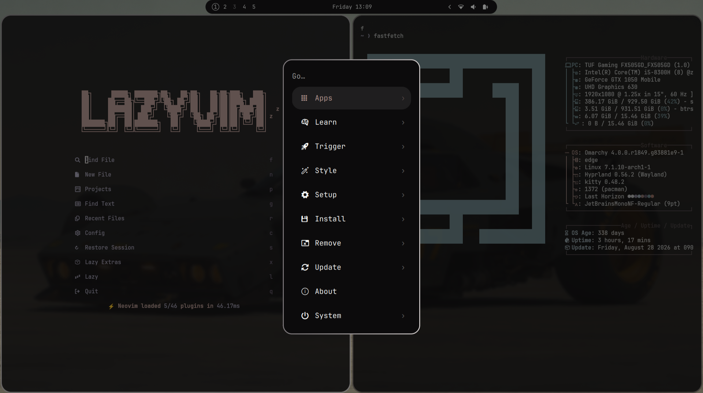

# omarchy-dotfiles
Personal settings for omarchy quattro



## Setup

```sh
git clone git@github.com:Romanhan/omarchy-dotfiles.git ~/dotfiles
cd ~/dotfiles
./setup.sh
```

`setup.sh` runs every `install-scripts/install-*` script and then rebases the
dynamic island bar. `install-dotfiles` installs `stow` and links these packages
into `~/.config`:

```
bash  kitty  hypr  superfile  omarchy  vscode
```

Finish with `omarchy restart shell`.

## Notes

- **`shell.json`** is excluded from stow because the shell rewrites it
  atomically. The repo copy is a snapshot; after changing the bar run
  `install-scripts/sync-shell-json`, or push the snapshot to a fresh machine
  with `install-scripts/sync-shell-json --push`.
- **`monitors.lua`** is stowed, but Omarchy's monitor-scaling shortcut rewrites
  it with `sed -i`. The keybinding wrapper runs
  `install-scripts/sync-monitors` afterwards, which copies the live file back
  into the repo and swaps in the symlink with one atomic rename.
- **Dynamic island bar** is generated from the installed stock bar plus
  `island.patch`. After an Omarchy update run
  `omarchy/.config/omarchy/plugins/romanhan.bar/rebuild` (the post-update hook
  does this automatically for `omarchy update`).
- **Large upstream themes** (`blackgold`, `harbordark`, `dracula`) are cloned
  by `install-scripts/install-themes` and ignored by git. The small custom
  themes (`aether`, `redbull`) are tracked.
- **Flea** is installed from Omarchy's repo. Run `flea --default` once if it is
  not already the default file manager. If it replaced the `bindings.lua`
  symlink with a regular file, run `stow --adopt hypr` and review
  `git diff hypr/` before committing.
